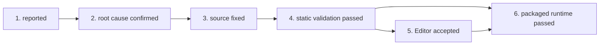

# Testing Feedback and Issue Lifecycle

[English](testing-feedback-workflow.en.md)

Use this page to triage bug reports, playtest feedback, and editor warnings.

## 离线优先验收

普通检查不启动编辑器或游戏；地图运行测试默认使用 `sc2_validate_run_test`，自动离线生成、检查、打包并直接启动游戏收集 Bank 和增量日志。仅不支持的结构、原生保存或专项编辑器验收才说明原因后使用编辑器。具体流程与证据要求见 [offline testing](../guides/offline-testing.md)。

生命周期的 `Editor accepted` 是按需分支；离线运行可从 `static validation passed` 直接达到有范围的 `packaged runtime passed`，不冒充编辑器验收。账本 `Validation Route: offline` 需要 `Offline Validation` 和实际运行证据；旧账本缺省走 `editor`。

---

## 6-Stage Issue Lifecycle

The Editor route follows this lifecycle; the offline branch is defined above:

1. **`reported`**: The issue is recorded in the active ledger (`<project-data>/docs/issues.md`) with reproduction context:
   - Map / mission
   - Player/faction configuration
   - Observed behavior vs expected behavior
   - Exact SC2 Editor warning text or in-game error log (from `<project-data>/runtime/reports/bugreport.txt`)
2. **`root cause confirmed`**: The root catalog ID, parent inheritance flaw, or Galaxy script logic error is identified.
3. **`source fixed`**: Working-tree source files (`Base.SC2Data/GameData/*.xml`, `Base.SC2Data/Scripts/*.galaxy`, etc.) are updated.
4. **`static validation passed`**: the required checks for the affected target/scope execute with zero errors. Report that scope; a passing subset does not certify a blocked full check.
5. **`Editor accepted`**: The SC2 Editor opens the modified mod/map cleanly without XML schema warnings, missing dependency errors, or trigger compile failures.
6. **`packaged runtime passed`**: The change is tested and verified in-game.

## Required outcome wording

Every handoff and completion report must name the highest gate actually reached. Use the exact lifecycle label, not ambiguous phrases such as “fully fixed”, “complete”, or “ready” when only static evidence exists.

- A zero-exit pre-flight run authorizes only **`static validation passed`**.
- **`Editor accepted`** requires the person operating the Editor to report a clean reload/compile/save of the affected component source.
- **`packaged runtime passed`** requires recorded in-game reproduction steps and observed results.

`tools/audit-issue-lifecycle.py` enforces valid active-ledger status labels and the evidence fields required by each reached gate.

`Validation` records static target/scope, checks and results. `Editor Validation` is required for the editor route from `Editor accepted`; offline runtime records require `Offline Validation`; record the component and reload/compile/save outcome. `Runtime Validation` is required from `packaged runtime passed`; record the tested version/target, reproduction steps and observed outcome. The audit checks record completeness, not whether those actions actually occurred. Existing high-stage records missing evidence fail without automatic rewriting or demotion.

---

## Issue Intake Rules

For runtime symptoms use [runtime diagnostics](runtime-diagnostics.md). A candidate patch and its static checks do not establish causality; keep an unconfirmed original symptom at `reported`, and report patch/check evidence separately. When an earlier hypothesis fails, remove its unsupported workaround before adding a new one.

- **Statistic Changes:** Before editing XML statistics, record the local catalog entry, parent, inherited value, and intended override in the ledger.
- **UI & Text Fixes:** Identify the exact UI surface (world hover, selection card, command card button, tooltip, or editor text) and its effective localization anchor before modifying `GameStrings.txt` or `ObjectStrings.txt`.
- **Runtime Log Extraction:** Run `python tools/extract-playtest-bugreport.py` after a playtest session to extract `Alerts.txt` and `ScriptError.txt` entries into `<project-data>/runtime/reports/bugreport.txt`.

---

## Ledger Maintenance

Maintain the current issue ledger in `<project-data>/docs/issues.md`. Keep the active ledger concise. Move durable system facts to canonical topic pages rather than retaining long historical discussions in the active ledger.
